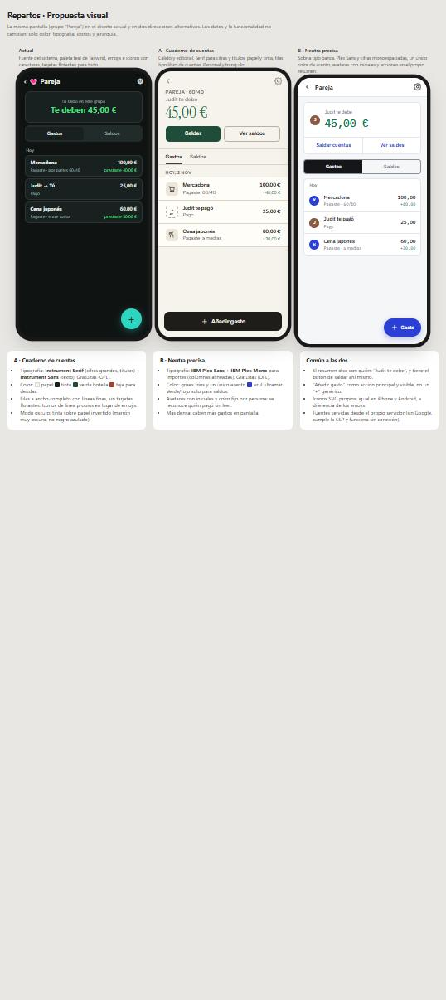
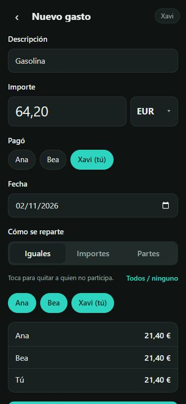
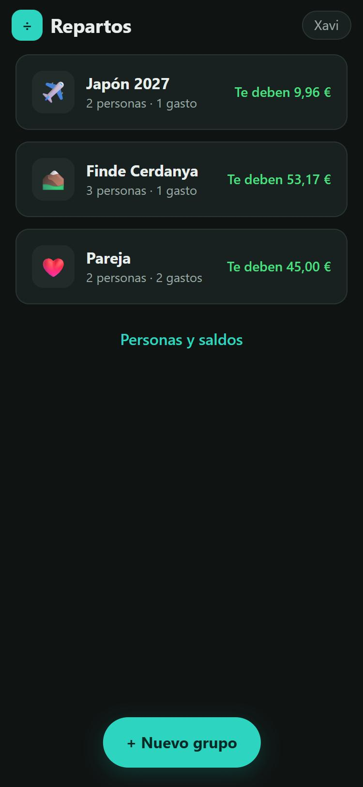
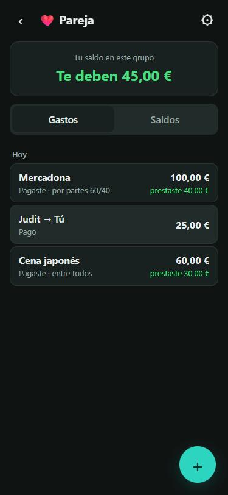
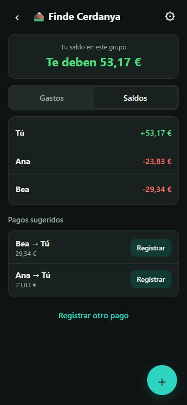
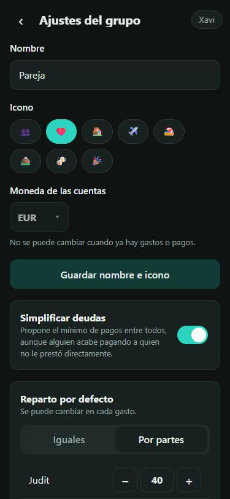

# Repartos · Auditoría de diseño y UX

Fecha: 2 nov 2026 · Revisado en móvil (375 × 812), modo oscuro y claro, con datos reales de prueba (Pareja, Finde Cerdanya, Japón 2027).

**Resumen:** la app funciona bien y es correcta, pero tiene dos problemas de fondo.

1. **El flujo más frecuente es más lento de lo necesario.** Apuntar un gasto pide entrar en el grupo, bajar con scroll hasta el botón de guardar y elegir dos veces a las mismas personas.
2. **El aspecto es el "por defecto" de una app generada.** Usa la fuente del sistema, la paleta teal de Tailwind tal cual, emojis y caracteres como iconos, y tarjetas con borde y sombra para todo.

Ninguno de los dos es un error funcional, pero son los que hacen que se perciba como poco profesional.

---

## 1. Aspecto visual: por qué parece "diseño de IA"

| Rasgo | Dónde | Por qué se nota |
|---|---|---|
| **Paleta Tailwind sin tocar** | `#0f766e` (teal-700), `#2dd4bf` (teal-400), `#15803d` (green-700), `#4ade80` (green-400) | Son literalmente los colores de ejemplo de Tailwind: el "uniforme" de miles de apps generadas |
| **Fuente del sistema** | `system-ui` | Sin voz propia; además cambia entre iPhone (SF), Android (Roboto) y Windows (Segoe) |
| **Emojis como iconos** | Grupos (💗 ✈️ ⛰️), selector de icono | Se ven distintos en cada móvil, no casan con el texto y son el recurso típico de un prototipo |
| **Caracteres como iconos** | `‹` volver, `⚙` ajustes, `÷` logo, `→` pagos, `▾` | Grosor y alineación irregulares, sobre todo `‹` y `⚙`, que salen pequeños y desalineados |
| **Todo es una tarjeta** | Resumen, pestañas, cada gasto, cada lista | Borde de 1 px, radio y sombra en todos los bloques: no hay jerarquía, todo pesa lo mismo |
| **Botón "+" flotante redondo y brillante** | Grupo | Patrón genérico de Material; con brillo turquesa, aún más genérico |
| **Resumen centrado en caja** | "Tu saldo en este grupo" | Plantilla de panel; no dice con quién es la deuda |
| **Sin sistema** | CSS | 11 tamaños de letra distintos (13 a 32 px), 4 radios, 9 alturas de control: valores sueltos, no una escala |

### Contraste (medido, WCAG 2.2)

| Par | Claro | Oscuro | Estado |
|---|---|---|---|
| Texto / fondo | 15,3 | 15,8 | ✅ |
| Texto secundario / tarjeta | 5,6 | 6,7 | ✅ AA |
| Verde de saldo / tarjeta | 5,0 | 9,4 | ✅ AA |
| Rojo de saldo / tarjeta | 6,6 | 5,9 | ✅ AA |
| **Borde de campos / tarjeta** | **1,3** | **1,3** | ❌ WCAG 1.4.11 pide 3:1 para los límites de un control |
| **Verde frente a rojo** | **1,3** | **1,6** | ⚠️ Se distinguen solo por el tono: problema para daltonismo rojo-verde. Hoy se salva porque siempre hay texto ("Te deben", "Debes") o signo |

### Propuesta: dos direcciones

Maqueta navegable: [docs/auditoria/propuesta-visual.html](auditoria/propuesta-visual.html). Ábrela en el navegador; necesita internet para cargar las fuentes de la maqueta.

**A · Cuaderno de cuentas** (cálido, editorial)
- **Tipografía**: *Instrument Serif* para cifras grandes y títulos, *Instrument Sans* para el texto. Las dos son gratuitas (licencia OFL).
- **Color**: papel `#f6f3ed`, tinta `#1f1d19`, verde botella `#1f4d3a` como acento y teja `#a8432c` para deudas. El modo oscuro sería marrón tinta, no el negro azulado típico.
- **Estructura**: filas a ancho completo separadas por líneas finas, como un libro de cuentas, sin tarjetas flotantes. Iconos de línea propios.
- **Carácter**: personal y tranquilo. Encaja con una app para la pareja y los amigos.

**B · Neutra precisa** (sobria, tipo banca)
- **Tipografía**: *IBM Plex Sans* y *IBM Plex Mono* para los importes (las columnas quedan alineadas). Gratuitas (OFL).
- **Color**: grises fríos y un único acento azul ultramar `#2b3fd6`. El verde y el rojo se usan solo para saldos.
- **Personas**: avatares con iniciales y un color fijo por persona, para ver quién pagó sin leer.
- **Densidad**: más alta; caben más gastos en pantalla.

**Mi recomendación: A.** Es la que más se aleja del aspecto genérico y tiene más personalidad sin perder legibilidad. Los avatares con iniciales de B se pueden incorporar también a A.

**Común a ambas:**
- Iconos SVG propios, iguales en iPhone y Android.
- Fuentes servidas desde el propio servidor: cumplen la CSP y funcionan sin conexión.
- Escala fija de tamaños de letra (12 / 13 / 15 / 17 / 22 / 34 / 46), radios (8 / 12 / 999) y espaciado en múltiplos de 4.
- Bordes de los campos con contraste 3:1.
- El signo menos tipográfico (−) en lugar del guion.

---

## 2. Usabilidad, ordenada por impacto

### Alta: afecta a lo que más se usa

**U1 · El botón de guardar queda fuera de la pantalla.**
En "Nuevo gasto", con 3 personas, el botón "Añadir gasto" queda debajo del pliegue y obliga a hacer scroll en cada gasto.
→ Barra de acción fija abajo con el importe resumido: «Añadir gasto · 64,20 €».

**U2 · Apuntar un gasto pide entrar antes en el grupo.**
Desde el inicio, la acción visible es "+ Nuevo grupo", que se usa pocas veces.
→ En el inicio, "Añadir gasto" como acción principal, preseleccionando el último grupo usado. "Nuevo grupo" pasa a ser secundaria.

**U3 · El orden del formulario no sigue al pensamiento.**
Ahora va descripción, importe, quién pagó y fecha. Lo natural en el móvil es teclear el importe nada más abrir.
→ Importe arriba y grande, con el teclado numérico abierto. Debajo la descripción, y "Pagó" y "Fecha" como chips compactos con valores por defecto ("Tú", "Hoy").

**U4 · Las personas aparecen dos veces y con el mismo estilo para dos cosas distintas.**
"Pagó" (elegir una) y "Para quién" (elegir varias) usan chips idénticos. Además, debajo se repite la lista de esas mismas personas con lo que le toca a cada una.
→ Una sola lista de personas, cada una con su casilla y su importe calculado al lado. "Pagó" pasa a ser un selector distinto (un chip con avatar).

**U5 · El saldo no dice con quién.**
"Te deben 45,00 €" en Pareja; el dato útil es «Judit te debe 45,00 €». Y para saldar hay que ir a la pestaña Saldos y buscar el botón.
→ En grupos de dos, una frase con la persona. En grupos grandes, «Te deben 53,17 € · 2 personas». Y un botón **Saldar** en el propio resumen.

### Media

**U6 · En los pagos sugeridos, el importe está en pequeño y gris** y el botón dice "Registrar", que es ambiguo.
→ Importe grande en la fila y botón «Marcar pagado».

**U7 · Los ajustes guardan de dos formas.** El interruptor guarda al momento, mientras que el nombre, el icono y el reparto necesitan su propio botón. Es fácil salir sin guardar.
→ Todo se guarda al momento con un aviso discreto «Guardado», o un único botón al final.

**U8 · Confirmaciones con `window.confirm`.** El diálogo gris del navegador rompe la experiencia de app instalada, sobre todo en iOS.
→ Hoja inferior propia con la acción destructiva en rojo, o directamente el patrón "Deshacer" que ya se usa al borrar gastos.

**U9 · El inicio no da una visión global.** No hay un total («En total te deben 108,13 €») y queda mucho espacio vacío.
→ Cabecera con el total por moneda y la lista de grupos debajo.

**U10 · El chip "Xavi" de la barra no hace nada.** Ocupa sitio en todas las pantallas.
→ Quitarlo, o convertirlo en avatar con acceso a «Personas y saldos».

**U11 · Los pagos se muestran como "Judit → Tú".** La flecha es poco natural de leer.
→ «Judit te pagó» o «Pagaste a Ana».

### Baja

- **U12 · Fecha**: el selector nativo con formato `02/11/2026` ocupa una fila entera para algo que casi siempre es "hoy".
- **U13 · Emojis del icono de grupo**: en el selector salen pequeños, con mucho aire dentro de cada chip.
- **U14 · Categorías**: no hay icono por gasto (comida, transporte, alojamiento…). En un viaje con 40 gastos se escanea peor la lista. Sería una funcionalidad nueva y opcional, con autodetección por palabras ("Mercadona" → súper).
- **U15 · Modo claro**: los textos verdes de "prestaste" (`#15803d`) junto al negro se ven apagados. Con la paleta nueva se resuelve.

---

## 3. Lo que ya está bien (y hay que conservar)

- Los textos cumplen contraste AA en ambos modos.
- Las zonas táctiles son de 40–48 px, el tamaño adecuado para el dedo.
- La vista previa del reparto en directo y el estado "Asignado X de Y · faltan Z" en importes exactos.
- "Deshacer" al borrar, en lugar de pedir confirmación.
- El modo oscuro automático, el `inputmode` decimal en los importes y la fuente de 16 px en los campos (evita el zoom de iOS).

---

## 4. Plan propuesto

| Fase | Contenido | Esfuerzo |
|---|---|---|
| **V1 · Sistema visual** ✅ | Dirección **B · Neutra precisa**: IBM Plex autoalojada, tokens de color medidos (AA y bordes 3:1), escala tipográfica, iconos SVG, avatares con iniciales. Incluye ya U5 (resumen "Judit te debe" + Saldar), U6, U10 y U11 | Medio |
| **V2 · Flujo de gasto** ✅ | U1 a U4: barra fija con el importe, importe primero, chips de grupo, quién pagó y fecha, lista única de personas con su parte, "Añadir gasto" desde el inicio en el último grupo usado. "Me cobraron" plegado para que el formulario quepa en una pantalla | Medio |
| **V3 · Saldos e inicio** | U5, U6, U9, U10, U11: saldo con persona y botón Saldar, pagos claros, total global | Bajo |
| **V4 · Pulido** | U7, U8, U12, U13: guardado coherente, hojas propias, fecha compacta, iconos de grupo | Bajo |
| *Opcional* | U14: categorías con icono | Medio |

Cada fase se prueba en el navegador en vista móvil (claro y oscuro) antes de desplegar con `deploy-repartos.sh`.
